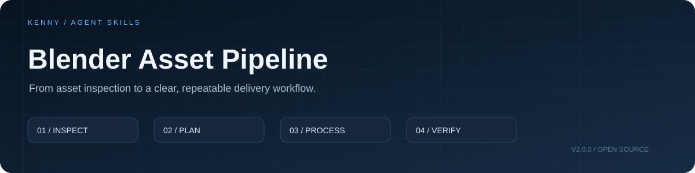

<p align="center"></p>

# Blender Asset Pipeline

**给 AI Agent 一套清楚的资产整理规则：命名、材质检查、批量导出与结果核对。**

`Blender` · `Agent Skill` · `Instruction-first` · `MIT`

An instruction-first Agent Skill for scoped Blender asset preparation and delivery.

## 一眼了解

| 能做什么 | 交付什么 |
|---|---|
| 按项目规则检查、规划资产命名 | 名称冲突清单与原名映射 |
| 检查材质槽、外部贴图及交付风险 | 有对象位置和原因的问题报告 |
| 组织按资产导出和重新导入核对 | 导出清单、失败项与验证状态 |

这是 **Skill 指令与规则包**。它让具备 Blender 操作能力的 Agent 有章可循；不包含独立 Blender 插件或预制批处理程序。执行依赖当前环境中的 Blender MCP / Blender Python 能力。

## 使用

1. 下载本仓库，将整个目录放到支持 `SKILL.md` 的 Agent 技能目录。
2. 在 Codex 中，目录名使用 `blender-asset-pipeline`，放入 `~/.codex/skills/`。
3. 连接 Blender 或指定可用的 Blender Python 环境后，说明对象范围和任务。

```text
使用 $blender-asset-pipeline 检查当前选择的资产。
先给出命名和材质问题清单；确认目标格式后，再在副本中整理与导出。
```

## 工作方式

**确定范围 → 检查状态 → 形成计划 → 执行授权操作 → 核对交付**

范围、格式、命名与修改权限由项目决定。相同规则重复运行应稳定；打包纹理、共享网格、库链接和特殊图像类型不会被简单粗暴地当成错误。

## 文件导航

- [SKILL.md](SKILL.md)：Agent 入口和完整工作流
- [规则参考](references/rules.md)：命名、材质、纹理、导出检查边界
- [交付记录](references/delivery-record.md)：报告字段与空模板
- [调用示例](examples/requests.md)：检查 / 整理 / 交付的实际提问方式

## 当前范围

首版交付为技能文档；没有附加制作演示或对生产资产批量执行处理。实际项目的运行结果、耗时与效果应由使用时的现场验证产生。

## 作者与许可

Kenny / 李铿 · [GitHub](https://github.com/KKKKKennys) · [作品集](https://kkkkkennys.github.io/)

规则由作者结合美术制作需求整理，并在 AI 辅助下编写。采用 [MIT License](LICENSE)。
